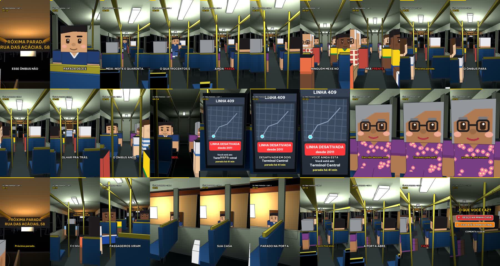

# Terror-Series-Skill

Skill do Claude Code (`serie-terror`) para criar séries de terror em capítulos para Shorts, Reels e TikTok, em 3D.



Skill que conduz a criação de séries de terror em capítulos para Shorts/Reels: propõe premissas, escreve o roteiro,
produz o vídeo em 3D no Blender com vozes do ElevenLabs e, no fim de cada capítulo, o público vota A ou B.
Cada etapa (premissa, roteiro, vídeo) passa pela aprovação de quem está usando, e o estado da série fica salvo para
as continuações.

## O que tem aqui
```
skill/serie-terror/SKILL.md      a skill (fluxo de aprovação, regras de elenco, padrões)
estudio/
  GUIA_PRODUCAO.md               o que funciona, o que evitar, lições de cada capítulo
  gerar_drama.py                 monta um capítulo: falas, sons, render no Blender, legendas, tela A/B
  drama.py                       vozes por personagem e sons de ambiente gerados por código
  eleven.py                      integração com o ElevenLabs (com cache de falas)
  gerar3d.py, historia_shorts.py, animacao_shorts.py   utilidades usadas pelo gerar_drama
  blender/mundo3d.py             biblioteca 3D: cenários (hall de prédio, ônibus), bonecos, câmeras
  blender/render_cena.py         script que o Blender executa para cada cena
  blender/fazer_skins.py         pinta as skins dos personagens (elenco brasileiro)
  blender/fazer_texturas*.py     texturas com texto (painéis, celular, folha de regras)
  blender/skins_br/, texturas/   imagens já geradas
  series/roteiros/               roteiros escritos
  series/ultima_parada/          plano e estado do capítulo de referência ("Última Parada", cap. 1)
  series/portaria/               plano de outra série ("Portaria da Noite", cap. 1)
```

## O que NÃO está aqui (e precisa ser instalado à parte)
1. **MoneyPrinterTurbo** — https://github.com/harry0703/MoneyPrinterTurbo. A pasta `estudio/` vai dentro dele e usa o
   ambiente Python (`.venv`), a fonte `resource/fonts/BeVietnamPro-Bold.ttf` e alguns módulos do projeto.
2. **Blender 4.5 LTS** — https://www.blender.org. O caminho esperado está em `BLENDER`, no começo de `gerar3d.py`.
3. **Modelos do Kenney (licença CC0)** — https://kenney.nl/assets/blocky-characters, extraídos em
   `estudio/blender/kenney/blocky-characters/`. Depois copie `blender/skins_br/*.png` para
   `kenney/blocky-characters/Models/GLB format/Textures/` ou rode `fazer_skins.py`.
4. **FFmpeg** no PATH.
5. **Chave do ElevenLabs** — crie o arquivo `estudio/elevenlabs_key.txt` com a sua chave (ele está no `.gitignore`;
   nunca suba esse arquivo). As vozes de cada personagem ficam em `vozes_elevenlabs.json`.

## Instalação
0. Clone este repositório: `git clone https://github.com/collafilipe/Terror-Series-Skill.git`
1. Copie `estudio/` para dentro da pasta do MoneyPrinterTurbo.
2. Copie `skill/serie-terror/` para `~/.claude/skills/` (no Windows: `C:\Users\<você>\.claude\skills\`).
3. Abra o `SKILL.md` e troque `<pasta do MoneyPrinterTurbo>` pelo caminho real no seu computador.
4. Numa conversa nova do Claude Code, escreva `/serie-terror`.

## Uso direto, sem a skill
```
.venv\Scripts\python.exe estudio\gerar_drama.py estudio\series\ultima_parada\cap1_plano.py --previa
.venv\Scripts\python.exe estudio\gerar_drama.py estudio\series\ultima_parada\cap1_plano.py
```
A primeira linha gera uma folha de prévias; a segunda renderiza o vídeo final (30 a 45 minutos).

## Avisos
- Foi desenvolvido e testado só no Windows 11, com uma placa AMD. Em outro sistema, os caminhos e o Blender podem
  precisar de ajuste.
- Confira os termos do seu plano do ElevenLabs antes de monetizar vídeos com as vozes dele.
- Os modelos do Kenney são CC0. As histórias desta pasta são originais.

## Licença
Ainda sem licença definida. Até que uma seja adicionada, todos os direitos são reservados ao autor.
